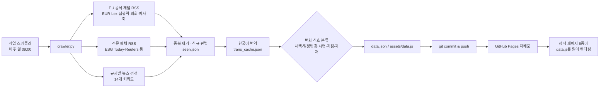

# EU ESG 규제 모니터링

[](https://esg-monitoring.kmbridge.org)

> 자동차부품사를 위한 EU ESG 규제 자동 모니터링 — 매주 월요일 스스로 수집·분석·배포되는 정적 웹 서비스
>
> **운영 중인 사이트 → <https://esg-monitoring.kmbridge.org>**

K-Mobility 브릿지 재단(자동차부품산업진흥재단)에서 현대차그룹 협력사(자동차부품사)의
EU ESG 규제 대응을 지원하기 위해 운영합니다. 기획부터 개발·배포·운영 자동화까지
현업 담당자가 AI 페어 프로그래밍(Claude Code)으로 직접 구축했습니다.
이 저장소의 `weekly auto-update` 커밋 기록이 실제 운영 이력입니다.

---

## 1. 문제 상황 (Problem)

- EU ESG 규제(CBAM, CSDDD, EUDR, 배터리 규정 등 14종)는 **협상·채택·시행 일정이 수시로 바뀌는데**,
  부품사 실무자가 영어 원문 뉴스와 EU 공식 채널을 매주 직접 확인하는 것은 사실상 불가능했습니다.
- 재단 담당자도 규제 동향을 **수작업으로 검색·번역·정리**해 공유했기 때문에 시간이 많이 들고,
  사람이 놓치면 그대로 공백이 생겼습니다.
- 뉴스가 많다고 다 중요한 것이 아니어서, **"그래서 우리 회사가 지금 확인해야 할 변화가 무엇인가"**에
  답해 주는 화면이 필요했습니다.

## 2. 해결 방법 (Solution)

**매주 자동으로 돌아가는 수집 파이프라인 + 역할별로 쪼갠 정적 대시보드**를 만들었습니다.

- Python 크롤러가 EU 공식 채널(EUR-Lex·집행위·유럽의회·이사회)과 전문 매체 RSS,
  규제별 키워드 뉴스 검색 14건을 수집하고 제목·요약을 한국어로 번역해 `assets/data.js` 하나로 만듭니다.
- 키워드 규칙(`채택·의결` / `일정·범위 변경` / `시행·기한` / `지침·기준 공표` / `집행·제재`)으로
  **규제 상태가 실제로 움직인 기사만 「확인 필요」 신호**로 분류합니다.
  신규 기사 여부는 `seen.json` 기준선으로 판별합니다.
- 페이지는 전부 정적 HTML이고 데이터 파일만 매주 갱신됩니다. Windows 작업 스케줄러가
  크롤러 실행 → git push → GitHub Pages 재배포까지 무인으로 처리합니다.
- 방문자는 회사 규모·EU 거래 형태를 고르면 14개 규제가 **직접 적용 / 고객사를 통한 간접 영향 /
  관련 낮음**으로 재정렬됩니다(브라우저 localStorage만 사용, 서버 전송 없음).

## 3. 효과 (Impact)

| 항목 | 변화 |
|---|---|
| 주간 동향 정리 시간 | [직접 입력: 예) 반나절 수작업 → 자동 수집 + 검수 20분] |
| 모니터링 공백 | 담당자 부재와 무관하게 매주 월 09:00 자동 수집 (실패 시 기존 데이터 보존) |
| 활용 | [직접 입력: 예) 재단 보고·협력사 안내에 활용, 주간 방문 수 ○○회] |

## 4. 화면 구성

| 페이지 | 내용 |
|---|---|
| [규제 현황](https://esg-monitoring.kmbridge.org/) | 규제 14종의 상태·시행일·관련 동향. 회사 규모와 EU 거래 형태를 고르면 직접 적용인지 고객사를 통한 간접 영향인지 재정렬 |
| [시행 캘린더](https://esg-monitoring.kmbridge.org/calendar.html) | 연도별 전체 시행 일정, D-day 표시 |
| [확인 필요](https://esg-monitoring.kmbridge.org/alerts.html) | 규제 상태가 움직인 기사만 규제별로 모아 보기 |
| [주간 동향](https://esg-monitoring.kmbridge.org/weekly.html) | 주차별 아카이브 + 재단 이슈 브리핑(근거 기사 링크 포함) |
| [규제 상세](https://esg-monitoring.kmbridge.org/reg.html?id=cbam) | 적용 대상·시행 일정·벌칙, 완성차 고객사를 거쳐 협력사로 내려오는 요구 구조 해설 |
| [시스템 소개](https://esg-monitoring.kmbridge.org/about.html) | 수집 방식과 데이터 출처 |

<details>
<summary>감시 중인 규제 14종 펼쳐 보기</summary>

| 약칭 | 규제 |
|---|---|
| CSDDD | 기업 지속가능성 실사 지침 |
| CSRD | 기업 지속가능성 보고 지침 (ESRS) |
| EUDR | 산림전용 규정 |
| CBAM | 탄소국경조정제도 |
| 배터리 | EU 배터리 규정 |
| PPWR | 포장재·포장폐기물 규정 |
| ESPR | 지속가능제품 에코디자인 규정 |
| ELVR | 차량 순환성·폐차 규정안 (ELV) |
| FLR | 강제노동 결부 상품 금지 규정 |
| Omnibus | 지속가능성 간소화 패키지 |
| 그린클레임 | 그린워싱 규제 (ECGT · 그린클레임 지침안) |
| 택소노미 | EU 녹색분류체계 |
| SFDR | 지속가능금융 공시 규정 |
| RED III | 재생에너지 지침 |

</details>

## 5. 기술 스택과 선택 이유

| 영역 | 선택 | 이유 |
|---|---|---|
| 수집 | Python (feedparser, requests) | RSS·뉴스 검색 파싱, 외부 API 키 불필요 |
| 번역 | 구글 번역 공개 엔드포인트 + 로컬 캐시(`trans_cache.json`) | 비용 0, 재실행 시 캐시 재사용 |
| 화면 | 순수 HTML/CSS/JS (프레임워크·빌드 도구 없음) | 데이터 파일 교체만으로 갱신, 누구든 파일을 열어 고칠 수 있음 |
| 배포 | GitHub Pages + 커스텀 도메인 | 서버 운영비 0, git push가 곧 배포 |
| 자동화 | Windows 작업 스케줄러 + PowerShell(`run_weekly.ps1`) | 담당자 PC에서 무인 주간 실행 |
| 방문 통계 | GoatCounter | 스크립트 한 줄, 개인정보 수집 없음 — 위의 총 방문 수 배지가 여기서 나옵니다 |

비밀키·API 키는 사용하지 않습니다(공개 RSS·공개 번역 엔드포인트만 사용).
수집하는 것은 RSS가 제공하는 **제목·요약·링크**이며 기사 본문은 저장하지 않습니다.

## 6. 처리 흐름



## 7. 저장소 구조

```
index.html  calendar.html  alerts.html      화면 (빌드 도구 없이 그대로 서빙)
weekly.html  reg.html  about.html
assets/
  common.js        규제 정의 14종, 공통 렌더링·판별 로직
  style.css        전체 스타일
  data.js          크롤러가 생성 — 페이지가 읽는 데이터
crawler.py         수집 → 신호 탐지 → 번역 → data.js 생성
run_weekly.ps1     주간 자동 실행 스크립트 (작업 스케줄러가 호출)
comments.json      재단 이슈 브리핑 (주차별, 근거 기사 링크 포함)
data.json          data.js와 같은 내용의 읽기 쉬운 사본
seen.json          이미 본 기사 링크 (신규 판별 기준선)
trans_cache.json   번역 캐시
CNAME              사용자 지정 도메인
```

## 8. 직접 돌려보기

```bash
pip install feedparser requests
python crawler.py                 # 수집 + 번역 + data.js 생성 (수 분 소요)
python -m http.server 8000        # http://localhost:8000 에서 확인
```

크롤러 없이 화면만 보려면, 이 저장소에는 이미 운영 데이터(`assets/data.js`)가 들어 있으므로
`python -m http.server 8000`만 실행해도 됩니다.

자동 실행은 `run_weekly.ps1`이 담당합니다. Windows 작업 스케줄러에 등록해 두면
수집부터 `git push`까지 한 번에 처리합니다. 스크립트 안의 Python 경로는 실행 환경에 맞게 맞춰 주세요.

## 9. 만들면서 정한 것 / 배운 점

- **빌드 도구를 쓰지 않습니다.** Node나 번들러 없이 HTML·CSS·JS를 그대로 올립니다.
  누구든 파일을 열어 고칠 수 있게 하기 위해서입니다.
- **서술은 확인된 것만.** 규제 해설과 이슈 브리핑은 수집된 기사나 규제 조문 구조에서 따라오는
  내용만 쓰고, 업계 일반론으로 메우지 않는다는 작성 기준을 명문화했습니다.
- **브리핑에는 근거를 답니다.** 이슈 브리핑의 각 항목은 제목을 누르면 근거가 된 원문 기사로 이동합니다.
- **자동화는 빠졌을 때가 진짜 시작이었습니다.** 절전으로 인한 스케줄 누락, 네트워크 장애 시
  빈 데이터가 배포되는 사고를 겪고 나서 실행 조건 완화와 "수집 0건이면 기존 데이터 보존" 로직을 보강했습니다.
- 사용자(부품사 실무자·경영진)가 원하는 것은 많은 정보가 아니라 **"내가 지금 봐야 하는 변화"**라는 것.
  신호 분류 규칙과 회사 기준 필터가 이 요구에서 나왔습니다.

**개선 아이디어** — 뉴스레터 이메일 자동 발송, 번역 품질 개선(용어집 확장·LLM 번역),
규제 원문 조문 변경 diff 추적, 협력사별 관심 규제 구독 알림.

## 10. English Summary

A self-updating EU ESG regulation monitoring service built for Korean automotive-parts suppliers
in the Hyundai Motor Group supply chain. A Python crawler collects news weekly from official EU
channels and trade media, machine-translates it into Korean, and flags only the articles that
signal an actual regulatory status change (adoption, timeline shift, enforcement). The front end
is a framework-free static site on GitHub Pages, refreshed by an unattended weekly pipeline
(Task Scheduler → crawler → git push), with per-company relevance filtering done entirely in the
browser. Built end-to-end by a domain specialist using AI pair programming, it turned a half-day
manual research routine into an automated service — the `weekly auto-update` commit history in
this repository is the live operating record.

---

본 사이트는 공개된 EU 공식 채널과 전문 매체의 기사를 자동 수집해 정리한 참고 자료입니다.
규제 적용 여부와 대응 방법에 대한 법률 자문이 아니며, 실제 대응은 원문과 전문가 확인을
거쳐 판단하시기 바랍니다.

K-Mobility 브릿지 재단 · 문의 esg@kmbridge.org
